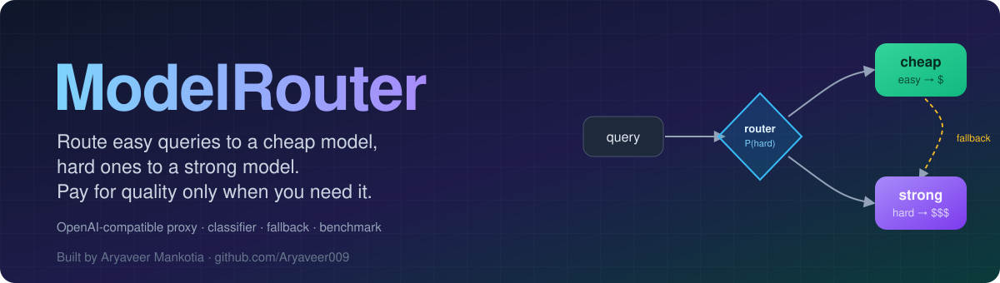
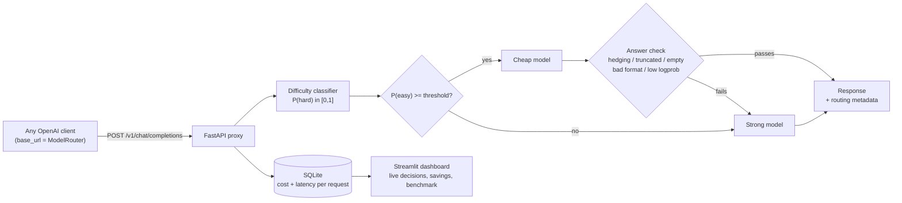
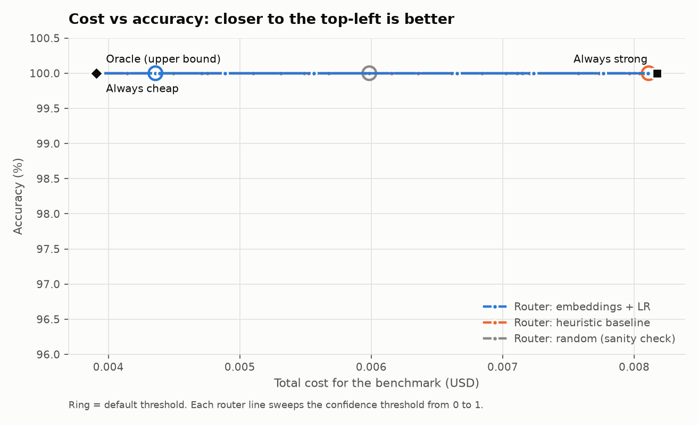

<p align="center">
  
</p>

<p align="center">
  <a href="https://github.com/Aryaveer009/modelrouter/actions/workflows/ci.yml"></a>
  
  
  
  
  
  
</p>

<p align="center">
  <b>A drop-in, OpenAI-compatible proxy that sends easy queries to a cheap model and hard ones to a strong model,<br>
  with automatic fallback and a benchmark that measures the real cost/quality tradeoff.</b>
</p>

---

## Why I built this

LLM bills are dominated by the strong model, yet a large share of real traffic (lookups, short factual questions, simple arithmetic) does not need it. I'm a CS student focused on AI engineering, and I wanted to answer a concrete question with measurements instead of intuition: *can a small classifier decide which queries need the expensive model, and how much money does that actually save without hurting quality?*

So I built the whole loop: a proxy any OpenAI client can point at, a difficulty classifier I trained on labels I generated myself, a fallback that catches the cheap model's bad answers, per-request cost tracking, and a benchmark harness that reports accuracy, cost, latency and "% cost saved at X% accuracy". I also made the harness refuse to analyse partial data and refuse to spend money without a printed estimate and a confirmation, because the interesting part of this project is getting numbers I can defend.

The results below are honest, and they are less flattering than a typical demo. Read [Results](#results-and-what-they-do-and-dont-show) before quoting any number.

*- Aryaveer Mankotia*

## Architecture



## How routing works

1. **Classify.** The last user message is scored by a difficulty classifier that returns `P(hard)`, meaning "the cheap model will probably get this wrong". Two classifiers ship:
   - a **heuristic baseline** (no training): length, digit ratio, arithmetic and math keywords, code cues, reasoning cues, multiple-choice format, and factoid cues, combined with hand-set weights through a sigmoid;
   - a **learned classifier**: `BAAI/bge-small-en-v1.5` sentence embeddings (ONNX via `fastembed`, no PyTorch) feeding a scikit-learn **logistic regression**. The fitted weights are stored as readable JSON in `models/classifier.json`, not a pickle.
2. **Decide.** The cheap model is used only when the classifier's confidence that the query is easy, `1 - P(hard)`, is at least `ROUTER_CONFIDENCE_THRESHOLD`. A higher threshold is more conservative: more traffic goes to the strong model.
3. **Check and fall back.** A cheap answer is escalated to the strong model if the call errored, the output is empty or truncated (`finish_reason=length`), the model hedges ("I'm not sure", "I don't know", ...), a multiple-choice question gets no choice letter, a numeric question gets no number, or (optionally) the mean token logprob is below a floor. You pay for both calls on an escalation, and the cost accounting counts both.
4. **Account.** Every request is logged to SQLite with tokens, latency and cost under your configured per-token prices. "Savings" compare the actual cost with what the strong model alone would have cost (for escalated requests that is the strong model's real cost; otherwise it re-prices the cheap model's token counts at strong prices, so treat it as an estimate).

### How the training labels were created

A label is `1` (hard) when the cheap model fails the query. I built the training set from public data (GSM8K, a 16-subject MMLU subset, TriviaQA; details and licences in [`data/README.md`](data/README.md)), ran the **cheap model once at temperature 0 on all 748 training queries**, scored each answer against the gold answer, and labelled it hard if it was wrong. A free "prior" labelling by source (e.g. all GSM8K = hard) also exists, but I did not use it for the shipped classifier, because it turned out to be backwards for this model pair (below).

### How the benchmark measures things

Each model answers each query exactly once (temperature 0, cached on disk so interrupted runs resume without re-spending). The router is then **replayed over the recorded answers** at 21 thresholds using the real `Router` class, so every strategy sees identical model outputs and the threshold sweep costs nothing. Alongside always-cheap and always-strong it reports a heuristic-baseline router, a random router (a sanity check: a useful classifier must beat it), and an oracle that knows in advance which model is right (an upper bound). Accuracy comes with Wilson 95% intervals, and the threshold-tuning estimates are also reported on a held-out half to avoid flattering the router by tuning on the test queries.

## Results and what they do and don't show

> **Read this first.** The full benchmark (300 queries: 100 GSM8K, 100 MMLU, 100 TriviaQA) was designed and the query set is in [`data/bench.jsonl`](data/bench.jsonl), but I could only complete it for part of the data. I ran on Groq's **free tier**, which allows 200,000 tokens per day per model. Labelling the 748 training queries used most of the cheap model's allowance, so only **52 benchmark queries, all GSM8K math**, got answers from both models. The numbers below are for exactly those 52 queries, produced with `modelrouter bench --only-cached`. They are real, but they are a small single-task sample.

Models: cheap = `openai/gpt-oss-20b`, strong = `openai/gpt-oss-120b`, both on Groq at low reasoning effort, temperature 0. Cost is computed from tokens at Groq's list prices as reported by third-party price trackers (cheap $0.10 in / $0.50 out, strong $0.15 in / $0.75 out per 1M tokens; I could not load Groq's own pricing page, and sources disagreed on the 20B price). The free tier meant I paid $0; the dollar columns are what the same tokens would cost at list price.

<!-- RESULTS:START -->
| Strategy | Accuracy (95% CI) | Total cost | Cost / 1k queries | Avg latency | Answered by cheap | Escalated | Cost saved vs strong | Accuracy vs strong |
|---|---|---|---|---|---|---|---|---|
| Always cheap | 100.0% (93.1%-100.0%) | $0.00391 | $0.0752 | 0.60s | 100% | 0% | +52.2% | +0.0 pp |
| Always strong | 100.0% (93.1%-100.0%) | $0.00818 | $0.1572 | 0.81s | 0% | 0% | +0.0% | +0.0 pp |
| Router (embedding, threshold 0.5) | 100.0% (93.1%-100.0%) | $0.00436 | $0.0838 | 0.63s | 87% | 0% | +46.7% | +0.0 pp |
<!-- RESULTS:END -->

<p align="center">
  <picture>
    <source media="(prefers-color-scheme: dark)" srcset="results/pareto-dark.png">
    
  </picture>
</p>

**What these numbers say**

- **Both models solved all 52 problems**, so there was nothing for a router to improve. Always-cheap is simply the best strategy on this sample: it saves **52.2%** of the cost at identical accuracy.
- **The router at the default threshold (0.5) saved 46.7%, which is worse than always-cheap (52.2%)**, because it sent 13% of queries to the strong model for no accuracy gain. The router matches the strong model's accuracy here, but this sample cannot show it beating a cheap-only policy. The "cost saved at X% accuracy" table in [`results/results.md`](results/results.md) shows 52.2% at every accuracy target, and the same figure for the random and heuristic routers, which is another way of saying the data has no signal to separate them. The classifier's AUC at predicting cheap-model failure is `n/a` on this sample because the cheap model never failed.
- **Do not read 46.7% or 52.2% as "ModelRouter saves 50%".** That would be a claim about a GSM8K-only sample of 52 queries against an easy-for-both-models task with a narrow price gap.

**What the real runs do show**

- **The cheap model is already strong, and the prior I built the free labels on was wrong.** On the 748 training queries the 20B model answered 93.6% of GSM8K (234/250), 85.5% of MMLU (212/248) and 72.0% of TriviaQA (180/250) correctly. The "hard" source was the easiest for it; the "easy" factual source was its weakest. Only 122 of 748 training queries (16%) are hard. This is exactly why labels come from the model's measured failures and not from the dataset's name.
- **The learned classifier is only modestly informative.** 5-fold cross-validated AUC for predicting cheap-model failure on the training set is **0.674** (accuracy 0.703 with balanced class weights). That is better than chance, far from a clean separator, and it explains why I would not expect large routing gains even on the full benchmark. Most of the cheap model's failures are on TriviaQA (70 of the 122), which are *knowledge* gaps that are hard to detect from the question text alone.
- **The strong model on the part of the benchmark it did answer** (288 of 300 queries; 12 calls failed on rate limits and are excluded): GSM8K 95.8% (92/96), MMLU 88.5% (85/96), TriviaQA 69.8% (67/96). Its TriviaQA score is not higher than the cheap model's training-set score, so on this pair the strong model buys little. Those are different query sets, so this is context, not a head-to-head.
- **The price gap between this pair is small** (list price only 1.5x), which caps how much any router can save. The 52% saving above is larger than that ratio only because the 20B model also generated fewer tokens per answer (mean 119 completion tokens against 179 for the 120B on these 52 queries). A pair with a larger price gap (for example a frontier model against a small one) leaves far more room, and I have not measured that.

**Audit trail.** Every raw model response behind these numbers is committed under [`results/cache/`](results/cache) (one JSON line per call, with tokens and latency), and `results/per_query.jsonl` has each query's routing decision and correctness.

**To complete the benchmark** once the free-tier quota refills (or with any paid key), run `modelrouter bench` again. Every answer already obtained is cached, so it only fills the gaps, then regenerates `results/` (including this table and chart through `python scripts/update_readme.py`).

## Quick start

```bash
git clone https://github.com/Aryaveer009/modelrouter && cd modelrouter
python -m venv .venv && source .venv/bin/activate
pip install -e ".[embeddings,dashboard,dev]"

cp .env.example .env       # then set CHEAP_*/STRONG_* models, base URLs, keys, prices
```

**Try it offline in 30 seconds (mock models, no keys, no cost):**

```bash
MODELROUTER_MOCK=1 modelrouter serve            # http://127.0.0.1:8000
curl localhost:8000/v1/chat/completions -H 'content-type: application/json' \
  -d '{"model":"modelrouter-auto","messages":[{"role":"user","content":"What is the capital of France?"}]}'
```

**Use it from any OpenAI client**, just change the base URL:

```python
from openai import OpenAI

client = OpenAI(base_url="http://127.0.0.1:8000/v1", api_key="unused")
resp = client.chat.completions.create(
    model="modelrouter-auto",      # or modelrouter-cheap / modelrouter-strong to force a route
    messages=[{"role": "user", "content": "A train travels 60 km/h for 2.5 hours. How far?"}],
)
print(resp.choices[0].message.content)
print(resp.model_extra["modelrouter"])   # route, p_hard, escalated, cost_usd, latency_ms
```

`stream=true` is accepted, but the router has to read the whole cheap answer before it can judge it, so the answer is delivered as a single chunk rather than token by token.

**Dashboard** (live decisions, cumulative cost vs always-strong, benchmark charts, a try-it box):

```bash
modelrouter demo --n 60                 # optional: synthetic MOCK traffic (clearly flagged)
streamlit run src/modelrouter/dashboard.py
```

**Reproduce the pipeline:**

```bash
modelrouter build-data                  # download GSM8K / MMLU / TriviaQA, write data/*.jsonl
modelrouter label                       # label training queries with the cheap model (prints cost, asks first)
modelrouter train                       # fit embeddings + logistic regression -> models/classifier.json
modelrouter bench --dry-run             # print the estimated spend and stop
modelrouter bench                       # ~300 queries; asks you to confirm any spend, supports --budget
pytest                                  # 83 tests, fully offline
```

**Cost safety.** Before any run that can spend money, `label` and `bench` print the estimated cost (expected and worst case) and ask for confirmation; `--yes` skips the prompt, `--budget USD` aborts if real spend crosses a cap, and a non-interactive shell refuses to spend without `--yes`. Runs that hit provider errors stop without analysing partial data.

**Docker:** `docker build -t modelrouter . && docker run --env-file .env -p 8000:8000 modelrouter` (the image pre-downloads the embedding model; I could not test the build locally because Docker is not installed on my machine, but CI builds it).

## Configuration

Everything comes from environment variables (see [`.env.example`](.env.example)): `CHEAP_*` / `STRONG_*` model name, base URL, API key, per-1M-token prices and optional extra request JSON (for example `{"reasoning_effort":"low"}`), plus `ROUTER_CONFIDENCE_THRESHOLD`, `ROUTER_CLASSIFIER` (`embedding` or `heuristic`), `ROUTER_FALLBACK`, `ROUTER_MIN_AVG_LOGPROB`, `MODELROUTER_MOCK`, and `MODELROUTER_DB`. Any OpenAI-compatible provider works for either model, and the two can be different providers.

## Project layout

```
src/modelrouter/
  server.py          FastAPI proxy (/v1/chat/completions, /v1/models, /stats)
  router.py          routing policy + fallback escalation
  uncertainty.py     answer checks that trigger escalation
  classifier/        heuristic baseline, embeddings + logistic regression, random baseline
  models.py          OpenAI-compatible client (retries, rate limits) and the offline mock
  costing.py         per-token cost accounting
  tracking.py        SQLite request log and summaries
  data/              dataset download and records
  bench/             answer scoring, runner (cache, budget guard), analysis, report
  dashboard.py       Streamlit app
tests/               83 pytest tests: classifier, router, cost accounting, server, benchmark
data/  models/  results/  docs/  scripts/
```

## Limitations

- The published results cover 52 GSM8K queries (see above); they do not demonstrate routing gains.
- Difficulty is predicted from the question text alone, so knowledge gaps are hard to anticipate; the fallback exists for that reason, at the price of paying for both models on an escalation.
- Savings for non-escalated requests are an estimate (cheap tokens re-priced at strong rates); the strong model may answer in a different number of tokens.
- Accuracy is exact-match style scoring (numeric tolerance, choice letter, answer-alias match), so a correct answer in an unusual format can be marked wrong.
- Latency is measured per call under light concurrency and includes provider-side queueing.

---

<p align="center">
  Built by <a href="https://github.com/Aryaveer009"><b>Aryaveer Mankotia</b></a> · MIT licence
</p>
